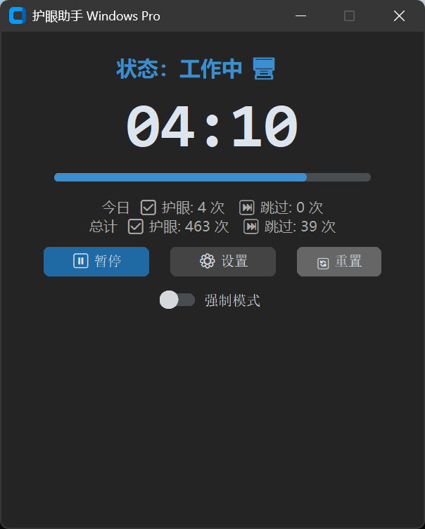
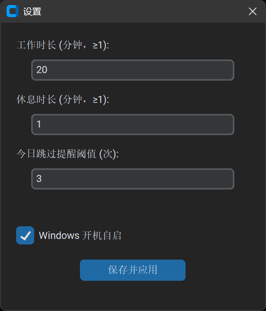
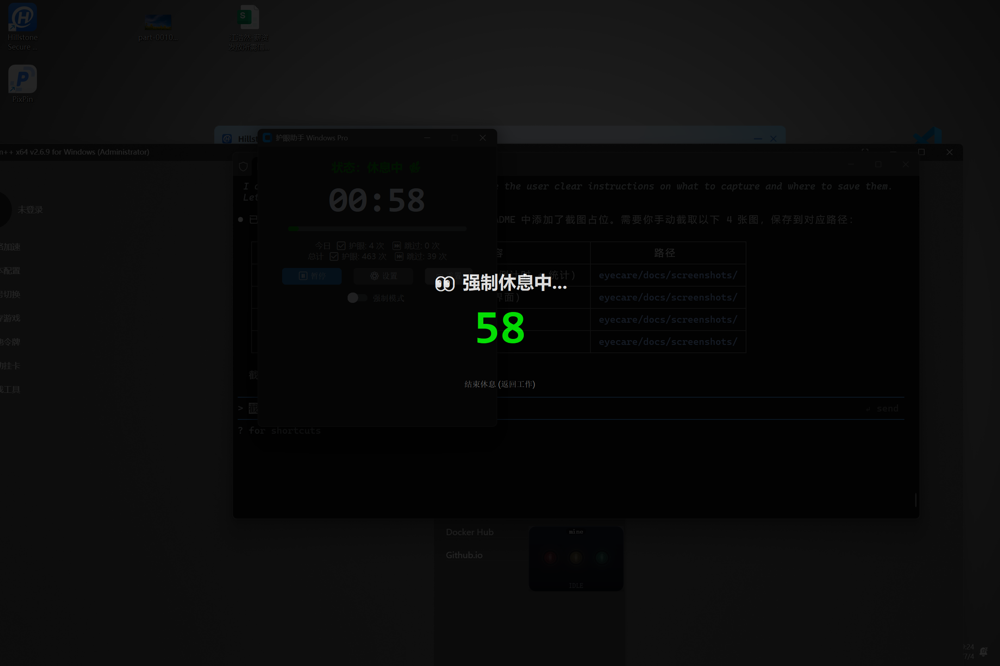

# 护眼助手 (EyeCare Windows Pro)

[](https://github.com/head-down/eyecare-windows-pro/stargazers)
[](https://github.com/head-down/eyecare-windows-pro/blob/master/LICENSE)
[](https://github.com/head-down/eyecare-windows-pro)
[](https://www.python.org/)
[](https://github.com/head-down/eyecare-windows-pro)

基于 customtkinter 的全屏遮罩式定时休息提醒工具。定时弹出遮罩强制休息，防止长时间盯屏。

## 截图

<p align="center">
  
  &nbsp;
  
</p>

<p align="center">
  
</p>

<p align="center">
  
</p>

## 星标趋势

[](https://star-history.com/#head-down/eyecare-windows-pro&Date)

## 原理

- 后台线程每秒轮询倒计时，到期自动弹出全屏遮罩进入休息阶段
- 遮罩使用 `overrideredirect(True)` 无边框窗口 + `SetWindowPos` 强制置顶，每 2 秒重新抬升防止全屏程序抢占
- 锁屏期间自动冻结计时（`OpenInputDesktop` API 检测），解锁后补偿冻结时长，避免锁屏期间累计休息时间
- 非强制模式下遮罩提供"跳过休息"按钮，可临时返回工作
- 跳过休息累计次数超过阈值（默认 3 次）自动开启强制模式，当日不可跳过
- 跨日自动刷新强制模式状态和每日统计计数
- 系统托盘常驻，支持显示/隐藏主窗口、暂停计时、退出
- Windows Mutex 单实例锁，防止重复启动
- 全局异常捕获，程序闪退时自动在桌面生成 `eye_care_error.log` 错误报告
- 支持 PyInstaller 打包为独立 exe（`护眼助手WindowsPro.exe`）

## 运行

```bash
cd eyecare
python eyecare_windows_pro_v1.0.2.py
```

## 依赖

```bash
pip install customtkinter pystray Pillow
```

## 配置

首次运行自动生成 `config.json`（与脚本/exe 同目录），也可通过托盘右键菜单 → 设置修改：

| 配置项 | 说明 |
|--------|------|
| `work_min` | 工作时长（分钟，默认 20） |
| `rest_min` | 休息时长（分钟，默认 1） |
| `skip_threshold` | 今日跳过提醒阈值（次，默认 3，超过自动开启强制模式） |
| `force_mode` | 强制模式开关（跳过按钮不可用，跨日自动关闭） |
| `auto_start` | Windows 开机自启（通过注册表 `HKCU\...\Run` 实现） |

运行时统计（也存储在 `config.json` 中）：
- `today_rest_count` / `today_skip_count` — 今日护眼/跳过次数
- `total_rest_count` / `total_skip_count` — 总计护眼/跳过次数
- 主窗口底部显示统计数字，跳过超标时变红警告，并提供"重置统计"按钮

## 平台

仅限 Windows（依赖 `winreg`、`winsound`、`ctypes.windll` 等 Windows 专属 API）。

## 许可证

MIT License - 眼睛是自己的，代码是公司的。
